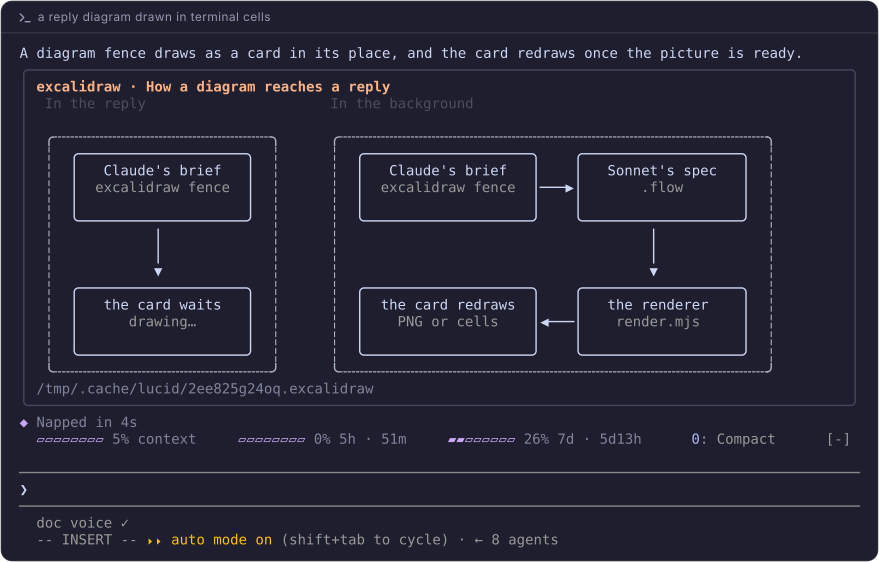
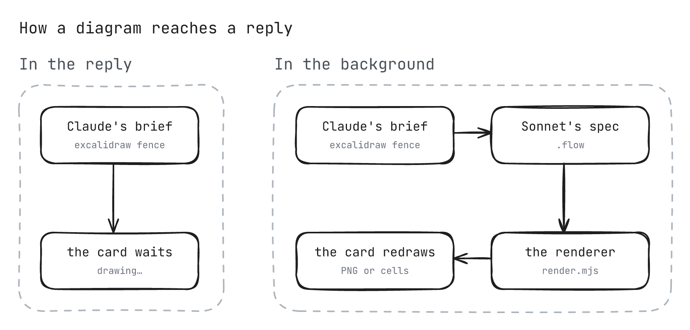

# lucid

A Claude Code mod that draws tool calls as compact, colour-coded cards in the
OMP style.


- **Tool cards:** edits, shell commands, reads, and searches share one look.
  Failures show in red
- **Densities:** choose how much each card shows
- **Reply tables:** Markdown tables draw as grids that fit the pane
- **Diagrams:** Claude draws a design or a flow as a diagram in its reply
- **`tldr`:** adds a short summary under a reply

## Densities

Set the level with `/lucid density <level>`. The default is `balanced`.

**`compact`:** one line per call.


**`full`:** every card shows its full preview.


**`blackbox`:** each run of calls folds into one block. Click a block to open
it. Claude's questions to you stay outside the blocks, with your answers.


## Replies

Wide tables wrap instead of losing text.


Long code blocks keep their colours.


## Diagrams

When a reply explains a design, a flow, or a before-and-after change, Claude
writes a short brief in an `excalidraw` code block. Claude Sonnet turns the
brief into a hand-drawn Excalidraw diagram in the background, and the diagram
draws in place of the block. Each card names its `.excalidraw` file, which
opens in Excalidraw.

Most terminals, and a terminal inside a multiplexer such as tmux, draw the
diagram in text.



Kitty and Ghostty show the hand-drawn picture.



`/lucid diagrams off` turns them off: Claude stops writing them, and the
blocks draw as code.

## `tldr`

Start or end a prompt with `tldr` to get a short summary under Claude's reply.
Send `tldr` on its own to summarize the previous reply.


`speak` reads a reply aloud the same way. It's experimental and off by
default: turn it on with `/lucid speak on`.

## Settings

| Command | Effect |
|---|---|
| `/lucid density <level>` | `balanced`, `compact`, `full`, or `blackbox` |
| `/lucid usage below` | Moves the context and plan meters under the prompt. `above` moves them back |
| `/lucid speak on` | Turns on the `speak` keyword. `off`, the default, turns it off |
| `/lucid voice <name>` | Sets the voice for `speak`. The default is `Samantha` |
| `/lucid diagrams off` | Turns diagrams off. `on`, the default, turns them back on |


## Install

Requires Claude Code 2.1.296 or later. The [skins
mod](https://github.com/hellosverre/claude-skins) installs alongside it.

```sh
claude plugin marketplace add hellosverre/claude-skins
claude plugin install skins@hellosverre-mods
claude plugin install lucid --marketplace Willmp4/lucid
```

Then run `/reload-plugins` in any open session.

To update:

```sh
claude plugin marketplace update lucid
claude plugin update lucid@lucid
```

To remove:

```sh
claude plugin uninstall lucid@lucid
```

Moving from omp-blocks, the mod's earlier name? Remove it and its
marketplace, then install lucid as above. Its settings start from their
defaults.

```sh
claude plugin uninstall omp-blocks@omp-blocks
claude plugin marketplace remove omp-blocks
```

Cards missing? Confirm in `/plugin` that both `lucid` and `skins` are
enabled, then run `/reload-plugins`.

The cards draw in the terminal only, with a dark palette. `tldr` sends the
reply to Claude Haiku. Diagrams send their brief to Claude Sonnet and draw
with `node`, which must be on your `PATH`; nothing else needs installing.
Mods run with Claude Code's access to your machine, so install only code you
trust.

## Development

```sh
claude plugin validate . --strict
claude plugin test .
claude --plugin-dir .
bun scripts/screenshot-svg.ts --all   # redraw the README pictures
```

[SPEC.md](SPEC.md) covers how the renderer works.

## Credits

[Andrew Forsyth](https://github.com/capoveur) wrote the diagram layout generator,
[`renderer/mkflow.mjs`](renderer/mkflow.mjs), and designed the `.flow` spec
format and the authoring rules the diagram model follows. He gave permission
to publish them here.

## License

[MIT](LICENSE). An independent community mod, not an official Anthropic
product.
