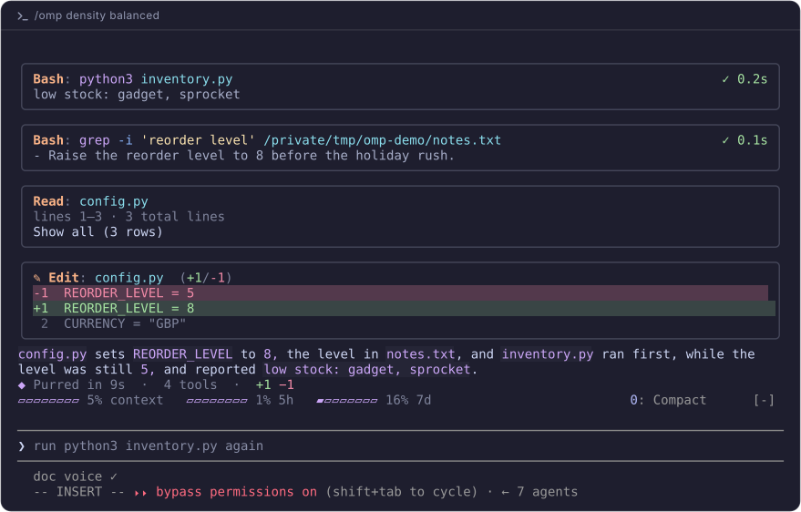
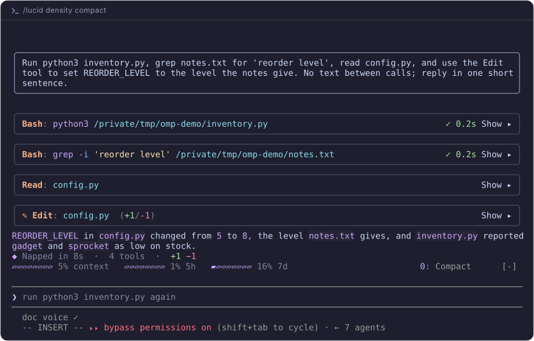
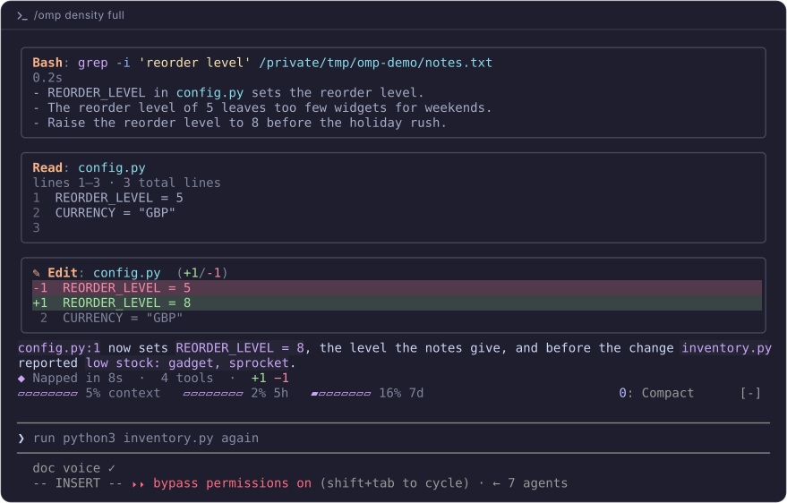
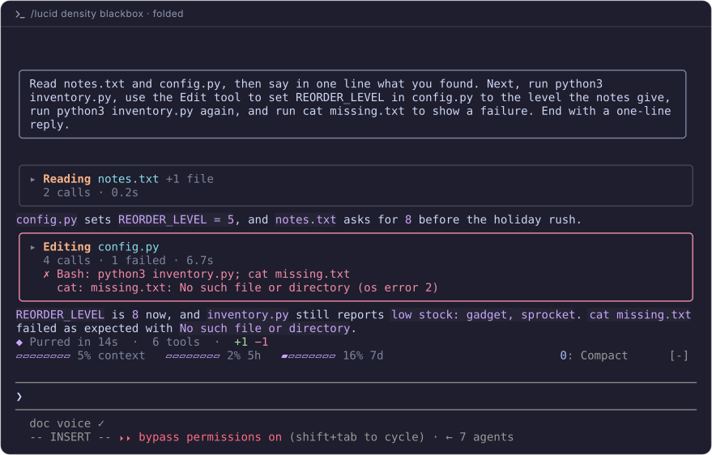
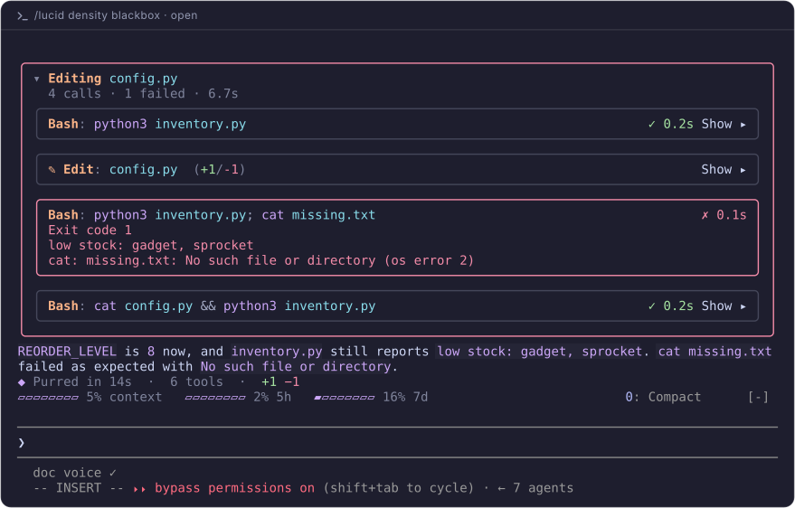
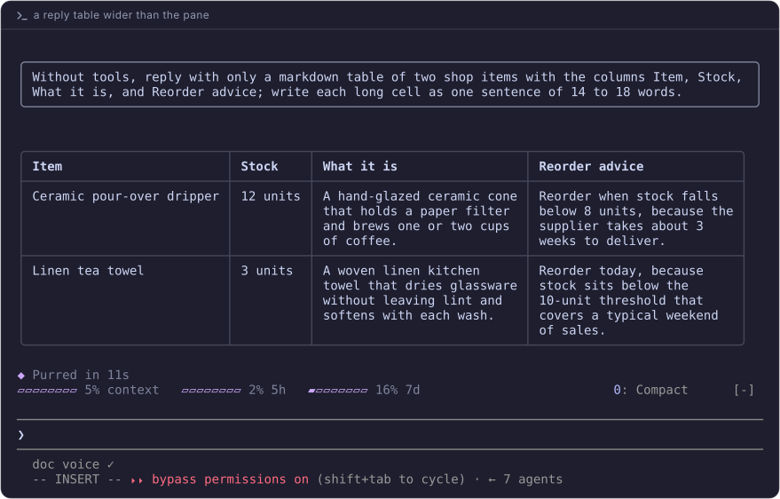
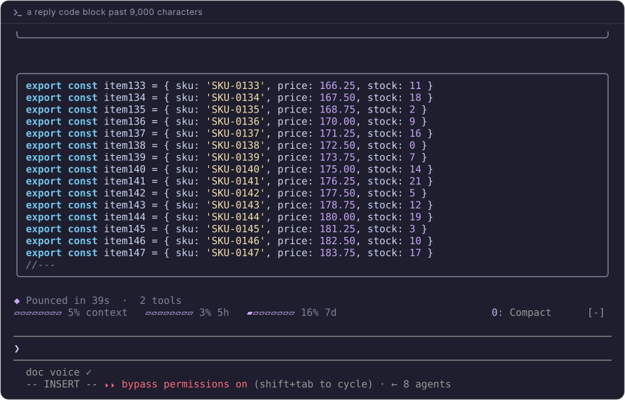
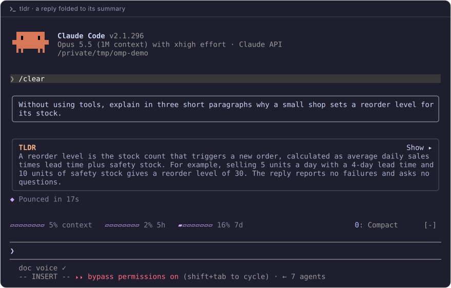
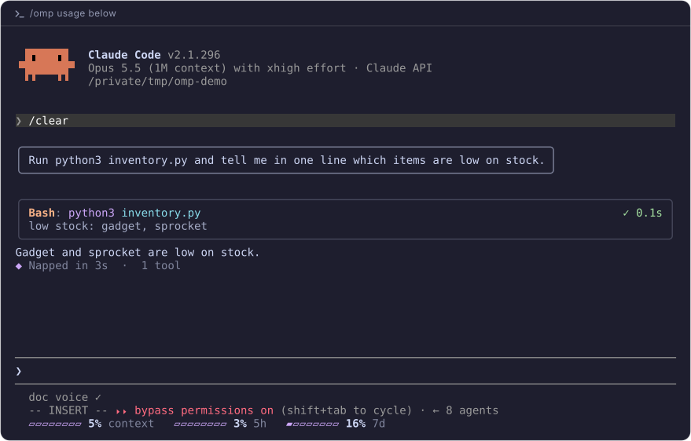

# omp-blocks

A Claude Code mod that draws tool calls as compact, colour-coded cards in the
OMP style.



- **Tool cards:** edits, shell commands, reads, and searches share one look.
  Failures show in red
- **Densities:** choose how much each card shows
- **Reply tables:** Markdown tables draw as grids that fit the pane
- **`tldr`:** adds a short summary under a reply

## Densities

Set the level with `/omp density <level>`. The default is `balanced`.

**`compact`:** one line per call.



**`full`:** every card shows its full preview.



**`blackbox`:** each run of calls folds into one block. Click a block to open
it.





## Replies

Wide tables wrap instead of losing text.



Long code blocks keep their colours.



## `tldr`

Start or end a prompt with `tldr` to get a short summary under Claude's reply.
Send `tldr` on its own to summarize the previous reply.



`speak` reads a reply aloud the same way. It's experimental and off by
default: turn it on with `/omp speak on`.

## Settings

| Command | Effect |
|---|---|
| `/omp density <level>` | `balanced`, `compact`, `full`, or `blackbox` |
| `/omp usage below` | Moves the context and plan meters under the prompt. `above` moves them back |
| `/omp speak on` | Turns on the `speak` keyword. `off`, the default, turns it off |
| `/omp voice <name>` | Sets the voice for `speak`. The default is `Samantha` |



## Install

Requires Claude Code 2.1.296 or later. The [skins
mod](https://github.com/hellosverre/claude-skins) installs alongside it.

```sh
claude plugin marketplace add hellosverre/claude-skins
claude plugin install skins@hellosverre-mods
claude plugin install omp-blocks --marketplace Willmp4/omp-blocks
```

Then run `/reload-plugins` in any open session.

To update:

```sh
claude plugin marketplace update omp-blocks
claude plugin update omp-blocks@omp-blocks
```

To remove:

```sh
claude plugin uninstall omp-blocks@omp-blocks
```

Cards missing? Confirm in `/plugin` that both `omp-blocks` and `skins` are
enabled, then run `/reload-plugins`.

The cards draw in the terminal only, with a dark palette. `tldr` sends the
reply to Claude Haiku. Mods run with Claude Code's access to your machine, so
install only code you trust.

## Development

```sh
claude plugin validate . --strict
claude plugin test .
claude --plugin-dir .
bun scripts/screenshot-svg.ts --all   # redraw the README pictures
```

[SPEC.md](SPEC.md) covers how the renderer works.

## License

[MIT](LICENSE). An independent community mod, not an official Anthropic
product.
